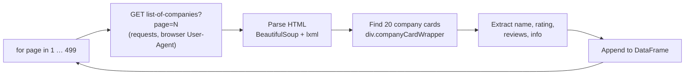

<div align="center">

# Company Ratings Web Scraper

**Collects name, rating, review count and company profile for ~10,000 companies<br>
from AmbitionBox's public company listing, into a tidy pandas DataFrame.**


[Notebook](Web_Scraping.ipynb)

</div>

---

## Overview

The scraper walks the paginated company listing at `ambitionbox.com/list-of-companies`, parses each
company card with BeautifulSoup and stacks the results into a single DataFrame. The committed run
collected **9,980 companies** across 499 pages, from TCS (66.9k reviews) down to companies with a few
dozen reviews.

## Output schema

| Column | Example | Description |
|---|---|---|
| `name` | `TCS` | Company name |
| `rating` | `3.8` | Average employee rating (out of 5) |
| `reviews` | `66.9k` | Number of employee reviews, as displayed |
| `cinfo` | `IT Services & Consulting \| 1 Lakh+ Employees \| …` | Industry, company size and other profile details |

## How it works



| Field | Selector |
|---|---|
| Company card | `div.companyCardWrapper` |
| Name | `h2` |
| Rating | `div.companyCardWrapper__companyRatingWrapper` |
| Reviews | `span.companyCardWrapper__ActionCount` |
| Info | `span.companyCardWrapper__interLinking` |

## Getting started

```bash
git clone https://github.com/Aman-Tripathi27/Web-Scrapping.git
cd Web-Scrapping
pip install requests beautifulsoup4 lxml pandas jupyter
jupyter lab Web_Scraping.ipynb
```

Run the cells in order: the first cells scrape and preview a single page, then the loop cell walks
every page and builds the full `final` DataFrame. Save it with `final.to_csv("companies.csv", index=False)`.

## Known issues

- `DataFrame.append` was removed in pandas 2.0. On current pandas, collect each page's frame in a list
  and call `pd.concat(frames, ignore_index=True)` once at the end.
- The CSS class names are tied to the site's current markup; if a selector returns `None`, re-inspect
  the page and update it.
- `reviews` is stored as displayed text (`66.9k`); convert it to an integer before numeric analysis.

## Responsible use

Scrape at a polite rate (add a delay between requests), respect the site's terms of use and
`robots.txt`, and use the data for personal or educational analysis only.

---

<div align="center">
<sub>Built by <a href="https://github.com/Aman-Tripathi27">Aman Tripathi</a> · <a href="https://amantripathii.netlify.app">Portfolio</a> · <a href="https://www.linkedin.com/in/aman-tripathi27/">LinkedIn</a></sub>
</div>
